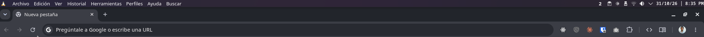

# Nombre del escritorio

Widget (plasmoide) para **KDE Plasma 6** que muestra el nombre del escritorio virtual actual.



## Características

- Muestra el nombre del escritorio virtual activo y se actualiza al cambiar de escritorio.
- Tooltip con la posición del escritorio (por ejemplo, "Escritorio 2 de 4").
- Rueda del ratón sobre el widget para cambiar de escritorio (cíclico).
- Configurable: tamaño de letra, negrita y color del texto.
- Funciona en Wayland y X11.

## Requisitos

- KDE Plasma 6.0 o superior

## Instalación

### Desde la KDE Store

1. Clic derecho en el panel o en el escritorio → **Añadir o gestionar widgets**.
2. **Obtener widgets nuevos** → **Descargar widgets nuevos de Plasma**.
3. Busca **"Nombre del escritorio"** e instálalo.

### Desde el archivo `.plasmoid`

```bash
kpackagetool6 -t Plasma/Applet -i org.andres.desktopname.plasmoid
```

### Desde el código fuente

```bash
git clone <url-del-repositorio>
cd <repositorio>
kpackagetool6 -t Plasma/Applet -i org.andres.desktopname
```

Si el widget no aparece en la lista, reinicia Plasma:

```bash
plasmashell --replace &
```

## Uso

1. Clic derecho en el panel o en el escritorio → **Añadir o gestionar widgets**.
2. Busca **"Nombre del escritorio"** y arrástralo a donde quieras.
3. Con la rueda del ratón sobre el widget cambias de escritorio.

Los nombres de los escritorios se cambian en **Configuración del sistema → Escritorios virtuales**.

## Configuración

Clic derecho sobre el widget → **Configurar Nombre del escritorio…**

| Opción | Descripción | Por defecto |
|---|---|---|
| Tamaño de letra | Automático (tamaño del tema) o manual, de 6 a 96 pt | Automático |
| Negrita | Muestra el texto en negrita | Activado |
| Color | Color del tema o uno personalizado (admite transparencia) | Color del tema |

## Actualizar

```bash
kpackagetool6 -t Plasma/Applet -u org.andres.desktopname.plasmoid
```

## Desinstalar

```bash
kpackagetool6 -t Plasma/Applet -r org.andres.desktopname
```

## Estructura

```
.
├── README.md
├── LICENSE
├── screenshots/                       # Capturas para el README
└── org.andres.desktopname/            # Paquete del widget
    ├── metadata.json                  # Nombre, versión e icono del widget
    └── contents/
        ├── config/
        │   ├── main.xml               # Opciones y valores por defecto
        │   └── config.qml             # Registro de la página de configuración
        └── ui/
            ├── main.qml               # Widget
            └── configGeneral.qml      # Formulario de configuración
```

### Generar el archivo `.plasmoid`

```bash
cd org.andres.desktopname
zip -r ../org.andres.desktopname.plasmoid metadata.json contents
```

## Licencia

GPL-2.0-or-later. Consulta el archivo [LICENSE](LICENSE).

---

## English

**Desktop Name** is a KDE Plasma 6 widget that shows the name of the current virtual desktop.

- Updates automatically when you switch desktops; scroll over it to switch desktops.
- Configurable font size, bold and text color.
- Works on Wayland and X11.

**Install:** `kpackagetool6 -t Plasma/Applet -i org.andres.desktopname.plasmoid`, then right-click the panel → *Add or Manage Widgets* → search for "Nombre del escritorio".

**Remove:** `kpackagetool6 -t Plasma/Applet -r org.andres.desktopname`
